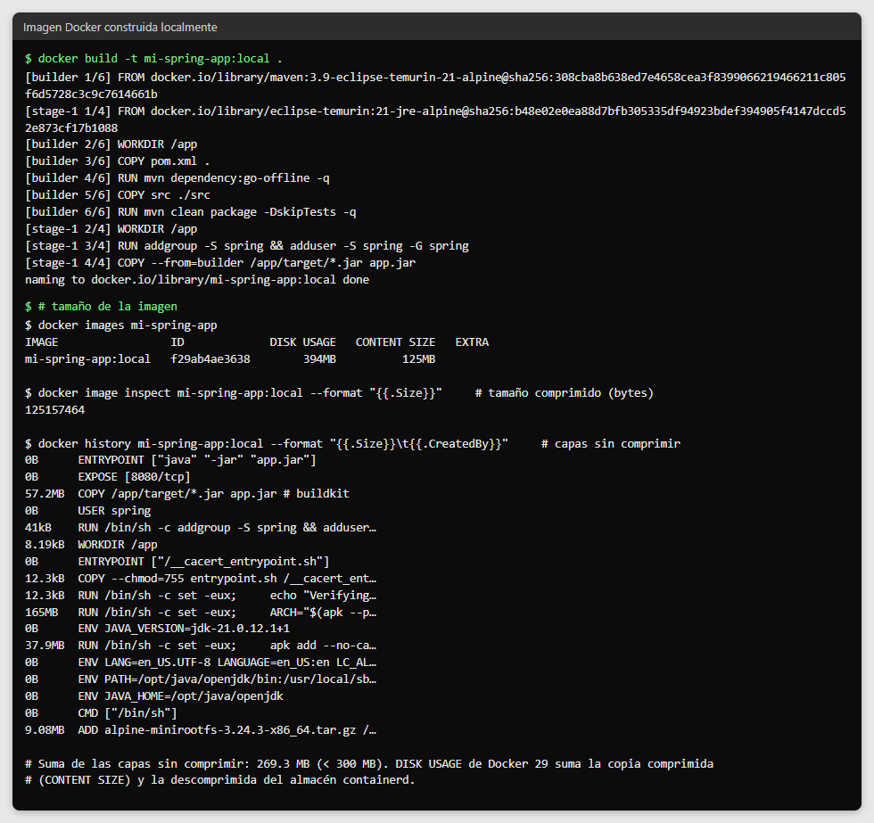
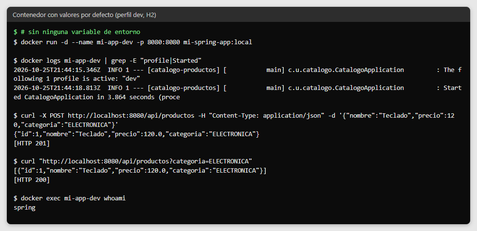
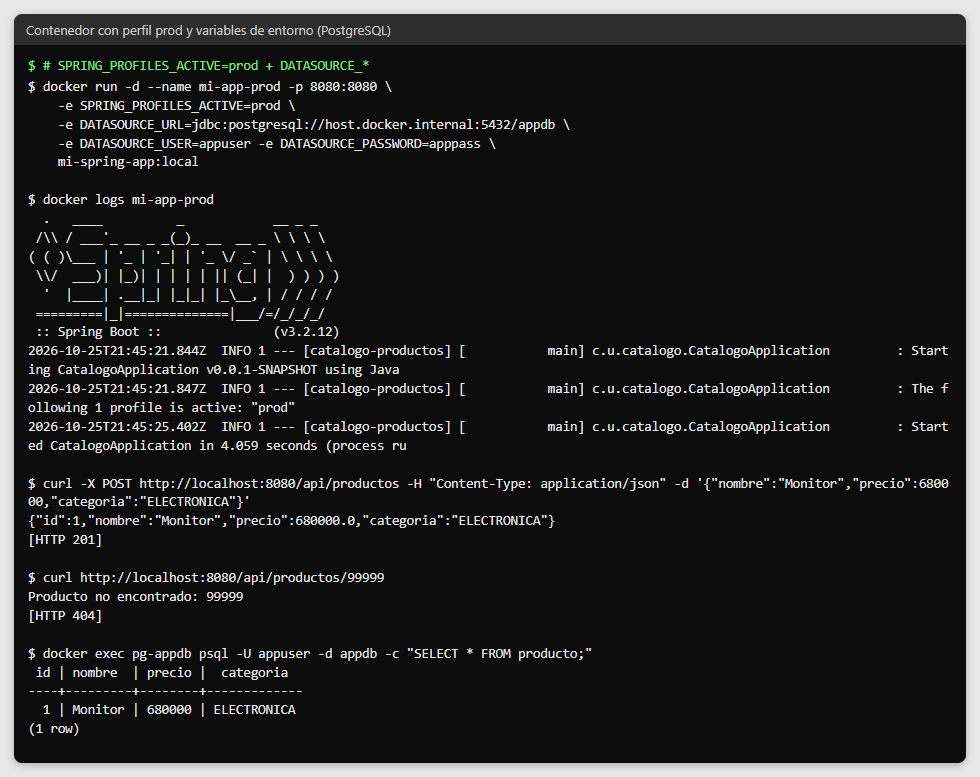
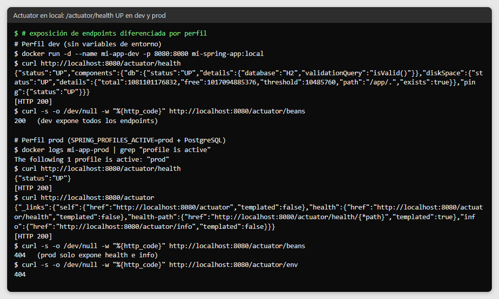

# Post-contenido — Unidad 12: Despliegue y CI/CD

## Descripción
Repositorio del laboratorio de la Unidad 12 de Programación Web —
Séptimo Semestre. Contiene la aplicación Spring Boot dockerizada
con un Dockerfile multi-stage y perfiles dev/prod (Parte 1), y su
extensión con un pipeline de integración continua con GitHub
Actions y monitoreo con Spring Boot Actuator (Parte 2).


**Aplicación base:** el catálogo de productos (`catalogo-productos`) construido en la Unidad 10:
API REST `/api/productos` sobre la entidad JPA `Producto`, con su suite de pruebas
(Mockito, `@DataJpaTest`, `@WebMvcTest`) y la colección Postman en `postman/`.

| Método | Ruta | Respuesta |
|---|---|---|
| POST | `/api/productos` | 201 con el producto creado; 400 si el nombre está vacío o el precio ≤ 0 |
| GET | `/api/productos/{id}` | 200 con el producto; 404 si no existe |
| GET | `/api/productos?categoria=X` | 200 con los productos de esa categoría |
| GET | `/actuator/health` | 200 `{"status":"UP"}` (monitoreo) |

## Estructura del repositorio
```
cardenas-post1-u12/
├── Dockerfile                        ← multi-stage: Maven + JDK 21 → JRE 21 Alpine, usuario no root
├── .dockerignore
├── .github/workflows/ci.yml          ← pipeline: build-and-test → docker-build (smoke test)
├── pom.xml                           ← incluye Actuator, H2 (dev) y PostgreSQL (prod)
├── src/main/resources/
│   ├── application.properties        ← base: puerto y perfil activo por variable de entorno
│   ├── application-dev.properties    ← H2 en memoria, todos los endpoints de Actuator
│   ├── application-prod.properties   ← PostgreSQL, solo health e info
│   └── schema-postgresql.sql         ← esquema del perfil prod
├── src/test/java/...                 ← ApplicationContextTest + pruebas de la Unidad 10
├── postman/                          ← colección de la Unidad 10
└── capturas/
```

## Parte 1 — Dockerización con Perfiles y Variables de Entorno
El Dockerfile multi-stage compila el proyecto con Maven en una
etapa JDK y ejecuta el JAR resultante en una etapa JRE Alpine con
un usuario no root. La configuración sensible se externaliza en
application.properties con placeholders `${VAR:default}`: sin
variables de entorno, la aplicación arranca con el perfil dev
(H2 en memoria); con `SPRING_PROFILES_ACTIVE=prod` y las variables
`DATASOURCE_URL` / `DATASOURCE_USER` / `DATASOURCE_PASSWORD`,
arranca con la configuración de producción (PostgreSQL). Esta aplicación
no usa JWT, por eso no define `JWT_SECRET`.

### Variables de entorno
| Variable | Perfil | Valor por defecto | Uso |
|---|---|---|---|
| `SPRING_PROFILES_ACTIVE` | ambos | `dev` | Perfil activo (`dev` o `prod`) |
| `PORT` | ambos | `8080` | Puerto HTTP (Railway y Render lo asignan) |
| `DATASOURCE_URL` | dev / prod | `jdbc:h2:mem:devdb` / `jdbc:postgresql://localhost:5432/appdb` | URL JDBC de la base de datos |
| `DATASOURCE_USER` | dev / prod | `sa` / `appuser` | Usuario de la base de datos |
| `DATASOURCE_PASSWORD` | dev / prod | vacío | Contraseña (en prod siempre se define por variable) |
| `DATASOURCE_DRIVER` | dev | `org.h2.Driver` | Driver JDBC del perfil dev |

### Resultados verificados
- `docker build` construye la imagen; sus capas suman **269 MB sin comprimir** (125 MB comprimida),
  por debajo de los 300 MB. Docker 29 muestra además un "DISK USAGE" de 394 MB porque su almacén
  (containerd) guarda a la vez la copia comprimida y la descomprimida.
- Sin variables: el log muestra `The following 1 profile is active: "dev"` y la API responde con H2.
- Con `SPRING_PROFILES_ACTIVE=prod` y las variables `DATASOURCE_*`: el log muestra
  `The following 1 profile is active: "prod"`, el esquema se valida contra PostgreSQL y los
  productos quedan guardados en la base.
- El contenedor se ejecuta como el usuario `spring` (no root).

## Parte 2 — Pipeline CI/CD con GitHub Actions y Monitoreo con Actuator
El pipeline (`.github/workflows/ci.yml`) se activa automáticamente en cada push y en cada pull
request hacia `main`, y realiza:
1. Compilación con Maven y ejecución de las pruebas unitarias
2. Construcción de la imagen Docker con multi-stage build
3. Smoke test: levanta el contenedor recién construido dentro
   del propio runner y verifica que /actuator/health responde UP,
   sin publicar la imagen en ningún registro externo

| Job | Depende de | Qué hace |
|---|---|---|
| `build-and-test` | — | Configura JDK 21 con caché de Maven (`actions/setup-java`, `cache: maven`), ejecuta `mvn clean verify` (19 pruebas y el umbral de cobertura de JaCoCo del 70%) y publica `target/surefire-reports/` como artefacto, incluso si las pruebas fallan (`if: always()`). |
| `docker-build` | `build-and-test` (`needs:`) | Construye la imagen con el mismo Dockerfile de la Parte 1, la levanta y consulta `/actuator/health` hasta 30 veces cada 2 s; termina en verde solo si responde `"status":"UP"`. Al final elimina el contenedor de prueba (`if: always()`). |

**Actuator por perfil:** en dev se exponen todos los endpoints con detalle completo
(`/actuator/beans` responde 200); en prod solo `health` e `info`, y `/actuator/health` devuelve
únicamente `{"status":"UP"}` (`/actuator/beans` y `/actuator/env` responden 404).

**Pruebas:** se reutilizan las 17 pruebas de la Unidad 10 y se agrega `ApplicationContextTest`
(`@SpringBootTest` + `@ActiveProfiles("dev")`), que construye el contexto completo y comprueba que
el indicador de salud responde UP, el mismo que consulta el smoke test.

## Despliegue (paso final manual)
Despliegue en **Render** a partir del mismo Dockerfile, sin que el workflow de GitHub Actions
almacene ningún Secret de la plataforma:

1. En [render.com](https://render.com), iniciar sesión con la cuenta de GitHub.
2. **New → PostgreSQL** (plan Free). Al crearse, copiar de *Connections* el **Hostname**, el
   **Database**, el **Username** y el **Password**.
3. **New → Web Service** → conectar el repositorio `cardenas-post1-u12`. Render detecta el
   `Dockerfile` (Language: Docker) y construye la imagen en su propia infraestructura. Plan Free.
4. En **Environment** definir:
   | Variable | Valor |
   |---|---|
   | `SPRING_PROFILES_ACTIVE` | `prod` |
   | `DATASOURCE_URL` | `jdbc:postgresql://<Hostname>:5432/<Database>` |
   | `DATASOURCE_USER` | `<Username>` |
   | `DATASOURCE_PASSWORD` | `<Password>` |

   `PORT` lo asigna Render y la aplicación lo toma con `server.port=${PORT:8080}`.
5. En **Health Check Path** escribir `/actuator/health` y crear el servicio.
6. Verificar `https://<servicio>.onrender.com/actuator/health` → `{"status":"UP"}`.

## Decisiones de diseño

### Parte 1
1. Placeholders con valor por defecto (`${VAR:default}`) en vez de
   placeholders estrictos: permite arrancar sin fricción en local
   y en CI, dejando los valores reales para producción.
2. `application-dev.properties` y `application-prod.properties` como
   archivos separados: hace explícito qué configuración corresponde
   a cada ambiente.
3. Imagen final eclipse-temurin JRE Alpine en vez de distroless:
   reduce el tamaño de la imagen sin sacrificar la posibilidad de
   depurar el contenedor con `docker exec`.
4. Etapa de compilación `maven:3.9-eclipse-temurin-21-alpine`: es el mismo JDK Temurin 21 sobre
   Alpine pero con Maven incluido; la imagen `eclipse-temurin:21-jdk-alpine` no trae el comando
   `mvn` y el `RUN mvn ...` fallaría.
5. Esquema de producción con `schema-postgresql.sql` (`CREATE TABLE IF NOT EXISTS`): en prod
   `ddl-auto=validate` no crea tablas, así que el esquema se crea con un script que solo se
   ejecuta con el perfil prod (`spring.sql.init.platform=postgresql`) y es seguro en cada reinicio.

### Parte 2
1. Prueba mínima de contexto en vez de omitir la fase de pruebas:
   garantiza que el job de CI valide algo real; además comprueba que
   el indicador de salud responde UP.
2. El job docker-build construye y verifica la imagen con un smoke
   test contra /actuator/health, pero no la publica en ningún
   registro: evita exigir una cuenta externa y Secrets solo para
   aprobar el laboratorio.
3. Exposición de Actuator diferenciada por perfil (todos los
   endpoints en dev, solo health e info en prod): evita exponer
   públicamente información sensible como variables de entorno.
4. Smoke test con hasta 30 intentos cada 2 s (60 s) en lugar de 15: en los runners la aplicación
   respondió UP en unos 8 s, pero el margen evita fallos intermitentes cuando el runner está lento.
5. `mvn clean verify` en vez de `mvn test`: además de las pruebas ejecuta el umbral de cobertura de
   JaCoCo heredado de la Unidad 10, de modo que el pipeline también falla si la cobertura baja.

## Cómo compilar y ejecutar
1. Clonar el repositorio: `git clone https://github.com/Moisex006/cardenas-post1-u12.git`
2. Construir la imagen localmente: `docker build -t mi-spring-app:local .`
3. Ejecutar con los valores por defecto (perfil dev): `docker run -p 8080:8080 mi-spring-app:local`
4. Ejecutar con perfil prod (requiere un PostgreSQL accesible):
   ```bash
   docker run -d --name pg-appdb -p 5432:5432 -e POSTGRES_DB=appdb \
     -e POSTGRES_USER=appuser -e POSTGRES_PASSWORD=apppass postgres:16-alpine

   docker run -p 8080:8080 \
     -e SPRING_PROFILES_ACTIVE=prod \
     -e DATASOURCE_URL=jdbc:postgresql://host.docker.internal:5432/appdb \
     -e DATASOURCE_USER=appuser \
     -e DATASOURCE_PASSWORD=apppass \
     mi-spring-app:local
   ```
5. Verificar el estado: `curl http://localhost:8080/actuator/health`
6. Ejecutar las pruebas sin Docker: `./mvnw clean verify`
7. Consultar el pipeline en la pestaña Actions del repositorio

## Capturas de pantalla
Las capturas de comandos muestran la salida real de `docker`, `curl` y de los logs.

Imagen Docker construida localmente:



Contenedor con los valores por defecto (perfil dev) y con perfil prod contra PostgreSQL:




`/actuator/health` respondiendo UP en local, con la exposición diferenciada por perfil:


